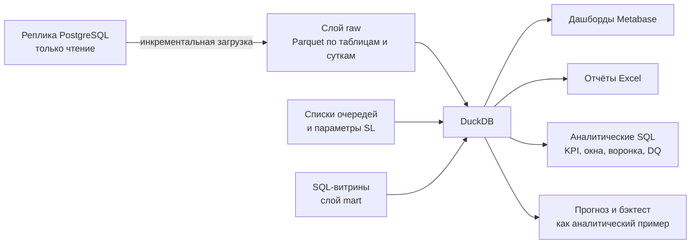
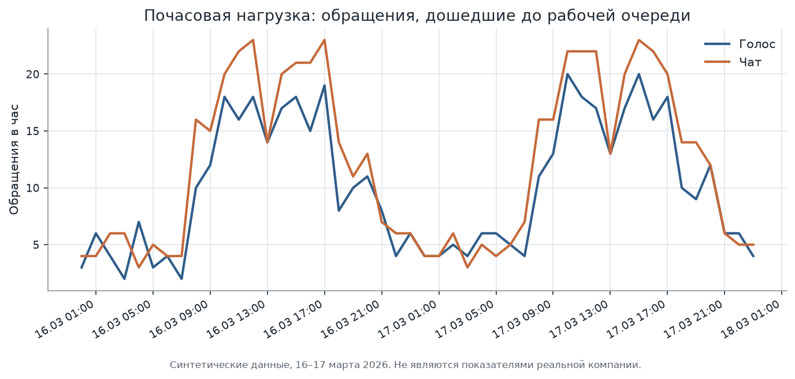
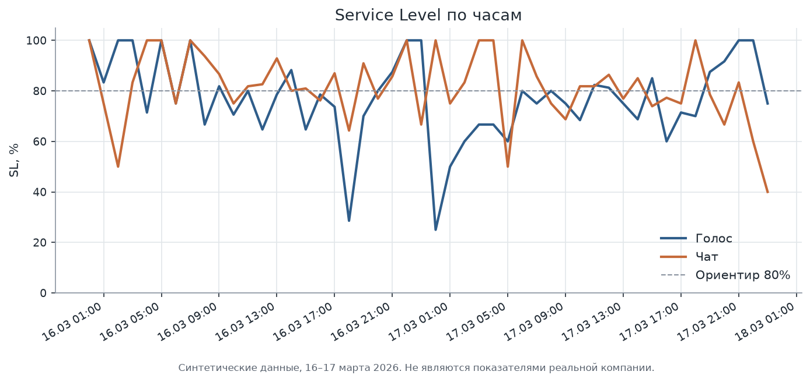
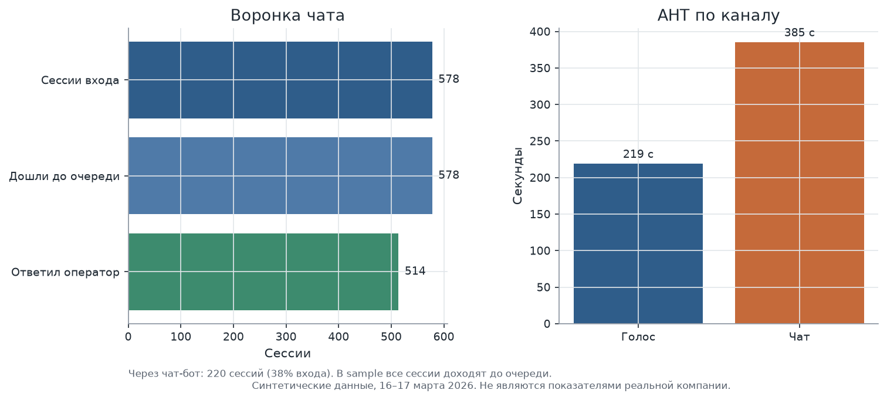

# Contact Center Analytics

I built an end-to-end analytics stack for a contact center: incremental ETL from a read-only PostgreSQL replica, storage in Parquet, calculations in DuckDB, SQL marts, Metabase dashboards and Excel reports. The same pipeline also feeds a volume forecast with backtesting, which I treat here as an analytics example, not as a boxed WFM product.

This public copy is a **generalized demonstration of the approach**. Company and product names, hostnames and production figures have been removed. Everything in `sample_data/` is **synthetic** and will not reproduce the business results listed below. Suggested GitHub repository name: `contact-center-analytics`.

Author: Maxim Filimonov ([maxpheelmo](https://github.com/maxpheelmo)).

---

# Аналитика контакт-центра

Я собрал аналитическую систему для контакт-центра: от сырых событий платформы до дашбордов, витрин и выводов для бизнеса. Считал нагрузку и качество сервиса по голосу, чату и почте, проверял данные, строил отчётность в Metabase и Excel и уже поверх тех же витрин делал прогноз с бэктестом.

Репозиторий: **обобщённая демонстрация подхода**, а не выгрузка рабочей инсталляции. Данные в `sample_data/` синтетические. Внутренние идентификаторы очередей, названия компании и клиентов, адреса баз и реальные цифры сюда не входят.

Автор: Максим Филимонов.

## Задача бизнеса

Контакт-центр работает в нескольких каналах (голос, чат, почта). Нужна была единая, воспроизводимая картина:

- сколько обращений пришло, сколько дошло до оператора, сколько потеряли;
- какой Service Level, AHT и ожидание по каналам, очередям и 30-минутным интервалам;
- почему просел сервис: мало людей, вырос AHT, ошибка в расчёте или дыра в данных;
- чтобы руководство смотрело дашборды, а не ждало ручную выгрузку.

Раньше данные были разрознены по источникам, отчёты собирались руками. Я собрал цепочку «источник → витрина → дашборд / книга Excel» и зафиксировал методологию показателей, чтобы одно и то же число считалось одинаково везде.

## Источники данных

Источник: реплика PostgreSQL, только чтение. Забираются события, не персональные данные клиентов (телефоны, адреса, имена в загрузчик не входят).

| Таблица | Что в ней |
|---|---|
| `voice_queued_calls` | Попадание звонка в очередь: когда встал, когда вышел, чем закончилось |
| `voice_call_legs` | Плечо разговора с оператором: соединение и окончание |
| `chat_session_iterations` | Итерации чата и почты: старт, распределение, первый ответ, закрытие |
| `agent_status_changes` | Журнал статусов оператора, в том числе `wrapup` для поствызывной |
| `dim_projects` | Справочник проектов и очередей |
| `dim_employees` | Справочник сотрудников (в sample логины вида `agent_01`) |

Каналы в модели: голос, чат, почта. У голоса отдельно учитываются входные точки (IVR), голосовой робот и прямые попадания в рабочую очередь. У чата: вход, чат-бот, рабочая очередь. Письмо сразу оказывается в очереди, отдельного «входа» у почты нет.

## Пайплайн



По шагам:

1. Реплика PostgreSQL, только чтение. Пароль берётся из диспетчера учётных данных Windows или из переменной окружения, не из файлов репозитория.
2. Загрузчик пишет колоночные файлы Parquet: первый прогон делает слепок по суткам, дальше догружает новые ключи с запасом `OVERLAP_DAYS`. Изменяемые строки чатов версионируются, при чтении берётся последняя версия.
3. DuckDB читает эти файлы как слой raw. Витрины слоя mart лежат в `sql/views/` (рабочая копия для кода: `py/views/`) и собираются при каждом подключении. На будущее предусмотрен backend `postgres` с теми же именами таблиц.
4. Metabase смотрит в ту же воронку, что и Excel-отчёты. Живые дашборды в репозиторий не входят, описание карточек и SQL: `docs/dashboards.md`.
5. Прогноз нагрузки, бэктест и план-факт считаются уже поверх витрин. В этом репозитории это пример аналитики на временном ряде, а не отдельный «продукт WFM».

Ключевые решения по методологии (показатели, AHT, прогноз, архитектура данных) коротко собраны в `docs/decisions.md`.

## Модель данных

Два слоя.

**raw.** Файлы Parquet один в один с источником: `voice_queued_calls`, `voice_call_legs`, `chat_session_iterations`, `agent_status_changes`, плюс справочники `dim_projects` и `dim_employees`. Настройки очередей, входов, бота и порогов SL подмешиваются из `py/wfm_settings.py` как небольшие таблицы (`support_queues`, `wfm_params` и соседние).

**mart.** SQL-представления, которые считает DuckDB при подключении:

| Витрина | Зерно | Зачем |
|---|---|---|
| `v_voice_contacts` | одно попадание звонка в рабочую очередь | ожидание, разговор, признак первого входа сессии |
| `v_text_contacts` | одна итерация чата или письма в рабочей очереди | ожидание ответа, ответили / закрыли без ответа |
| `v_interval_volume` | канал × 30 минут | объём, обработано, потери, SL. Основа отчётов и прогноза |
| `v_chat_sessions_interval` | 30 минут начала чат-сессии | воронка чата: вход, бот, очередь, ответ |
| `v_voice_sessions_interval` | 30 минут начала голосовой сессии | воронка голоса: IVR, робот, прямые входы |
| `v_aht_interval` | канал × 30 минут постановки в очередь | AHT: разговор + wrap-up на голосе, обработка на чате |
| `v_queue_check` | проект / очередь | сверка: отдел отвечает в очереди, которой нет в списке |
| `v_entry_check` | первый проект сессии | сверка входов: неизвестный канал или перевод |

Все аналитические примеры в `sql/analytics/` читают эти витрины и сырые таблицы, отдельно ничего не собирают.

## Показатели

Формулы зафиксированы в витринах и в журнале решений. Пороги по умолчанию: голос 30 с, чат 240 с, почта 24 ч. Короткий потерянный на голосе: быстрее 5 с, в знаменатель SL не входит.

| Показатель | Формула | Комментарий |
|---|---|---|
| Service Level (голос) | `handled_in_sl / (handled + abandoned − short_abandoned)` | Ответ за 30 с. Короткие потери знаменатель не раздувают |
| Service Level (чат, почта) | `handled_in_sl / entries` | Чат: ответ за 240 с. Почта: за 24 ч |
| AHT (голос) | среднее (`talk_sec + wrap_sec`) | Разговор плюс поствызывная из статуса `wrapup*` в узком окне вокруг конца разговора |
| AHT (чат) | среднее (закрытие − распределение на оператора) | Ожидание в очереди не входит. Параллельность чатов здесь не учитывается |
| ASA | среднее ожидание тех, кого взял оператор | Для неотвеченных в ASA не входит |
| Потери | `abandoned` | Голос: вышел из очереди без оператора. Чат/почта: закрыто без ответа |
| CSI | средняя оценка 1–5, одна последняя на обращение | Источник оценок в публичный sample не входил |
| Occupancy | `(talk + wrap) / (talk + wrap + available)` | Доля времени на линии, занятая работой с обращением |
| Utilization | `(talk + wrap) / время смены` | В рабочей модели от запланированного времени; в sample смены заданы статусом `ready` |

Разбор формул на данных: `sql/analytics/01_daily_kpis.sql`, `05_aht_and_agent_ranking.sql`, `06_occupancy_from_statuses.sql`.

## Дашборды

Три рабочих экрана в Metabase и один контур качества для аналитика. Подробно, с аудиторией, карточками и SQL: [`docs/dashboards.md`](docs/dashboards.md).

1. **Показатели за период.** SL, AHT, ASA, CSI, потери, воронка, объёмы по времени. Для руководства и разбора недели.
2. **Оперативный экран дня.** Те же формулы, но про сегодня: текущий интервал, накопительный итог, статусы, occupancy.
3. **Классификация обращений.** Темы и сегменты, сумма тем сверяется с воронкой входа.
4. **Качество данных.** Новые очереди и входы, сироты, выбросы длительностей.

На синтетике это выглядит так:







Картинки можно пересобрать: `python py/render_sample_charts.py` (нужен matplotlib).

## Качество данных

Цифру на дашборде я не считаю готовой, пока не пройдены проверки:

- нет отрицательных ожиданий и разговоров, нет `ended < connected`;
- у принятого звонка есть плечо разговора и логин оператора;
- `project_id` и логины находятся в справочниках;
- wrap-up находится для звонков в дни, где журнал статусов вообще есть;
- рабочие очереди и входы совпадают со списками в настройках (витрины `v_queue_check`, `v_entry_check`).

Каркас этих проверок: `sql/analytics/07_data_quality.sql`. На sample почти везде ноль ошибок. Так и задумано: синтетика собрана аккуратно, запрос показывает, что именно я проверял на боевых данных.

## Результаты

Цифры ниже относятся к рабочей системе, не к файлам в `sample_data/`. Повторить их на синтетике нельзя.

- Точность прогноза нагрузки выросла на 10–14% за счёт бэктеста и план-факт контроля.
- По результатам анализа данных выявлено и устранено систематическое занижение потребности в персонале на 28–30%.
- На одном из каналов Service Level в пиковые периоды вырос с 50% до 70% после того, как в расчётах нашли и исправили ошибки.

Отдельно: руководство и команды перешли с ручных выгрузок на дашборды с автоматическим обновлением, а разрозненные по источникам голос, чат и почта собраны в одну модель.

## Консоль `wfm.bat`: автоматизация для аналитика

`wfm.bat` (или `python py/wfm_menu.py`) это не «ещё одна WFM-коробка», а однокнопочный запуск регулярного цикла аналитика.

Что происходит на практике. Утром или по расписанию я не собираю выгрузки руками и не копирую SQL в редактор. Консоль догружает инкремент из реплики в Parquet, пересчитывает ряды на DuckDB и выгружает книги Excel: прогноз, точность, потребность. Те же витрины кормят Metabase, отдельно их обновлять не нужно.

| Пункт меню | Что это с точки зрения аналитика |
|---|---|
| 1. План на квартал | При необходимости догрузить источник и посчитать прогноз квартала с шагом 30 минут |
| 2. Недельный пересчёт | Тот же пайплайн на горизонт две недели, по свежим данным |
| 3. План на год | Годовой ряд. Сам черновик не публикует и утверждённую версию не затирает |
| 4. Точность | Сохранённые версии прогноза против факта, только по уже прошедшим дням |
| 5. Потребность | Численность на опубликованный квартал или год (уже как применение тех же рядов) |
| 6. Отпуска | Окна по готовой годовой потребности, прогноз заново не считает |
| 7. Настройки | Обновление данных, календарь событий, пароль, публикация |

Пункты 1–4 догружают источник, если данные старше нескольких часов. Для портфолио достаточно sample и SQL-примеров: живая реплика здесь не нужна. Без реплики и без своего модуля Erlang A пункты меню, которые ходят в базу или в калькулятор численности, не выполнятся. Это ожидаемо.

## Как запустить на sample

Нужны Python 3.10+ и зависимости из `requirements.txt`:

```bash
python -m venv .venv
# Windows: .venv\Scripts\activate
# Linux/macOS:
source .venv/bin/activate
pip install -r requirements.txt
```

Дальше, без живой базы:

```bash
python py/load_sample.py
python sql/analytics/run_examples.py
```

Первая команда переложит синтетические CSV в `data/<таблица>/sample.parquet`. Вторая выполнит примеры из `sql/analytics/` и обновит `docs/analytics_queries.md`.

Проверка витрин вручную:

```bash
python -c "import sys; sys.path.insert(0, 'py'); import wfm_store; print(wfm_store.query('select channel, day, sum(entries) entries from v_interval_volume group by 1, 2 order by 2, 1'))"
```

Если есть своя реплика: скопируйте `.env.example` в `.env`, сохраните пароль через `python py/save_password.py` (или задайте `SOURCE_PG_PASSWORD` только в окружении) и запустите `wfm.bat`. Идентификаторы очередей в `py/wfm_settings.py` сейчас заглушки, их нужно заменить на свои. Имена сырых таблиц в загрузчике тоже обобщены: подставьте имена своей схемы или заведите представления-синонимы в реплике.

## Структура репозитория

```
wfm.bat                 консоль (однокнопочный ETL + отчёты)
py/                     загрузка, витрины (views/), прогноз, меню
sql/views/              те же SQL-витрины, удобно смотреть отдельно от кода
sql/analytics/          примеры аналитических запросов (CTE, JOIN, окна, DQ)
docs/dashboards.md      дашборды: аудитория, карточки, SQL
docs/analytics_queries.md  вывод примеров на sample
docs/decisions.md       выжимка методологии
docs/img/               графики по синтетике
sample_data/            синтетические CSV
inputs/                 календарь событий, need.txt
data/                   хранилище Parquet (создаётся локально, в git не входит)
reports/                книги Excel (локально)
config.example.py       памятка по настройке
.env.example            шаблон переменных подключения
```

## Какие навыки здесь видны

- Проектирование витрин: слой raw и слой mart, зерно, сверка входа.
- ETL / ELT: инкрементальная загрузка из PostgreSQL, Parquet, DuckDB, обновление по расписанию.
- Аналитический SQL: CTE, JOIN нескольких источников, оконные функции (`LAG` / `LEAD`, `ROW_NUMBER`, скользящее среднее, накопительный итог, сравнение периодов).
- Определение метрик и управленческая отчётность: SL, AHT, ASA, потери, occupancy, воронка.
- Качество данных: набор проверок, без которых дашборд нельзя отдавать бизнесу.
- BI: карточки Metabase описаны так, чтобы их можно было воспроизвести запросом.
- Python: автоматизация загрузки, прогона отчётов и консоли.
- Прогнозирование на витринах, с бэктестом и план-фактом, как развитие той же аналитики.

## Важно

- Данные в `sample_data/` **синтетические**. Это не история обращений и не показатели какой-либо компании.
- Результаты про точность прогноза, численность и рост SL относятся к рабочей системе и на sample не воспроизводятся.
- В публичном sample голосовые сессии начинаются сразу в рабочей очереди (строк входного IVR нет), поэтому `entry_sessions = 0`, а весь голос попадает в `direct_queue`. На чате воронка полнее.
- Occupancy на sample низкий: синтетика нужна, чтобы показать схему статусов и формулу, а не типичную загрузку линии.
- Проект показывает подход. Он не является коробочной системой и не содержит секретов, паролей и персональных данных.
