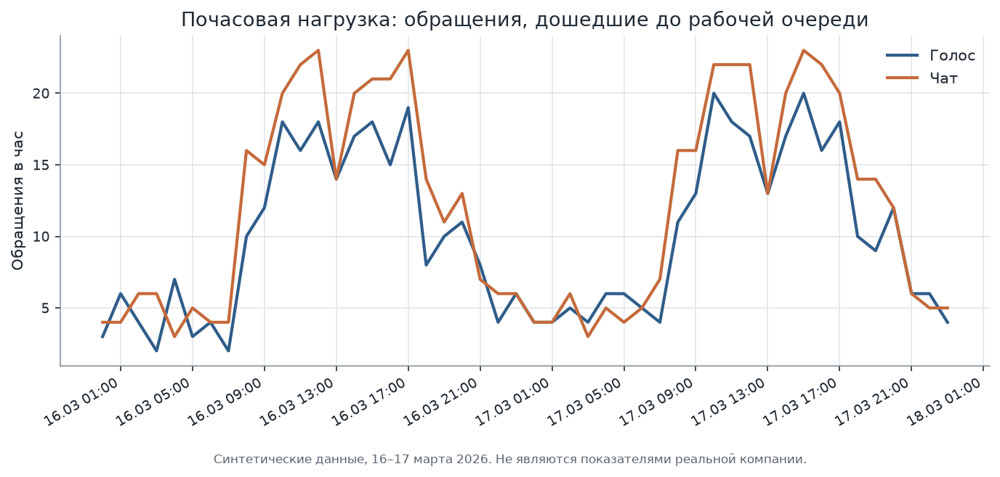
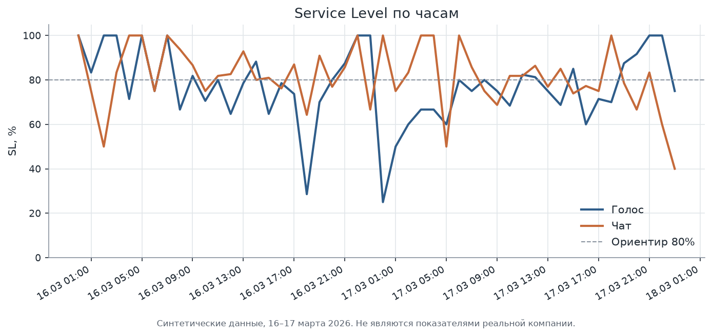
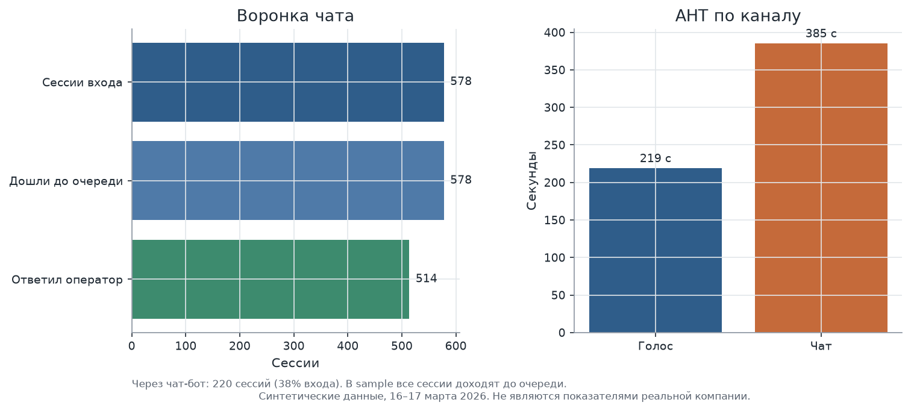

# Дашборды

Живые экраны остаются в Metabase и в этот репозиторий не входят. Ниже для каждого дашборда: зачем он нужен, кто им пользуется, из каких карточек состоит, какой SQL стоит за ключевыми карточками и какие решения он поддерживает.

Описание обобщено: без названий компании, внутренних отчётов и реальных объёмов. Примеры SQL считают те же витрины, что лежат в `sql/views/`. Картинки ниже построены по синтетическим данным из `sample_data/` (16–17 марта 2026) и не являются показателями реальной компании.







Полный прогон аналитических запросов с таблицами: [`analytics_queries.md`](analytics_queries.md).

---

## 1. Показатели за период

**Задача.** Дать единую картину сервиса за выбранный период: сколько обратились, сколько дошли до оператора, какой Service Level, сколько ждали, сколько длилась обработка, где были потери.

**Кто смотрит.** Руководитель контакт-центра и руководители направлений (голос, чат, почта). Раз в день или раз в неделю, не «каждую минуту».

**Какие решения опираются на этот экран.**
- Где просел SL: в одном канале, в одном окне времени или везде сразу.
- Растёт ли нагрузка быстрее, чем AHT успевает снижаться (или наоборот).
- Стоит ли разбирать конкретный день или очередь глубже, или отклонение укладывается в обычный разброс.
- Сходится ли «официальная» цифра с тем, что считает витрина (после того как методология зафиксирована).

Фильтры дашборда: период, канал, иногда проект/очередь. Сутки считаются с 00:00 до 00:00.

### Карточки

| Карточка | Что считает | Откуда |
|---|---|---|
| Всего поступило | Вход в службу. Голос: из меню и прямые в очередь. Чат: сессии. Почта: письма в очереди | `v_voice_sessions_interval`, `v_chat_sessions_interval`, `v_interval_volume` |
| Поступило на оператора | Из входа те, кто дошёл до рабочей очереди | `v_interval_volume.offered` / `entries` |
| Без оператора | Не дошли до очереди. Почта всегда 0: письмо сразу в очереди | вход минус очередь |
| Потеряно | Дошли до очереди и не получили ответ. На голосе короткое ожидание до 5 с в потери карточки может входить, но в знаменатель SL не входит | `v_interval_volume.abandoned` |
| SL | Доля отвеченных в пороге времени канала | `handled_in_sl` и формула канала |
| SL по времени | Та же формула, по часам или по дням | `v_interval_volume` |
| AHT | Голос: разговор и поствызывная. Чат: от распределения до закрытия. Почта: от назначения до ответа | `v_aht_interval` |
| ASA | Среднее ожидание тех, кто дошёл до оператора | `v_voice_contacts`, `v_text_contacts` |
| A1RT | Только чат: от распределения до первой реплики оператора | итерации чата |
| CSI оператора и бота | Средняя оценка 1–5, одна последняя на обращение | отдельный источник оценок, в публичный sample не входил |
| Объёмы по времени | Вход, на оператора, потеряно и без оператора на одной оси | интервальные витрины |
| Сервис по дням | Таблица входа, очереди, SL и AHT | те же витрины, зерно «день» |

### SQL ключевых карточек

Service Level за период (голос и текстовые каналы считаются по-разному):

```sql
select channel,
       sum(entries) as entries,
       sum(handled) as handled,
       sum(abandoned) as abandoned,
       case
           when channel = 'Голос'
               then 100.0 * sum(handled_in_sl)
                    / nullif(sum(handled) + sum(abandoned) - sum(short_abandoned), 0)
           else 100.0 * sum(handled_in_sl) / nullif(sum(entries), 0)
       end as sl_pct
from v_interval_volume
where day between :date_from and :date_to
group by channel;
```

AHT за период:

```sql
select channel,
       sum(handled) as handled,
       (sum(work_sec) + sum(wrap_sec)) / nullif(sum(handled), 0) as aht_sec
from v_aht_interval
where day between :date_from and :date_to
group by channel;
```

ASA (только отвеченные):

```sql
select 'Голос' as channel,
       avg(wait_sec) as asa_sec
from v_voice_contacts
where final_stage = 'operator'
  and cast(wait_start as date) between :date_from and :date_to
union all
select channel, avg(wait_answer_sec)
from v_text_contacts
where is_answered = 1
  and cast(wait_start as date) between :date_from and :date_to
group by channel;
```

Готовый запрос со всеми дневными KPI лежит в `sql/analytics/01_daily_kpis.sql`. Профиль по 30 минутам со сравнением «тот же слот вчера» : `sql/analytics/02_interval_windows.sql`.

---

## 2. Оперативный экран дня

**Задача.** Показать, что происходит сегодня, а не «за прошлую неделю». Нужен руководителю смены: успеваем ли держать SL, где сейчас пик, не растёт ли очередь.

**Кто смотрит.** Супервайзеры и руководитель смены в течение дня. Экран отдельный, в общий дашборд периода он не встроен, чтобы исторические фильтры не путались с «сейчас».

**Какие решения опираются на этот экран.**
- Усилить линию в ближайшие полчаса или перекинуть людей с другого канала.
- Разобрать конкретную очередь, если SL падает только в ней.
- Отличить «мало людей» от «вырос AHT» или «много коротких потерянных».
- К концу дня понять, стоит ли уже готовить разбор на оперативке.

Формулы сервиса те же, что на дашборде за период. Добавляется снимок статусов: кто на линии, чем занят, какая загрузка накопилась за день.

### Карточки

| Карточка | Что считает |
|---|---|
| SL сегодня / SL текущего интервала | Та же формула, но только за сегодня и за текущие 30 минут |
| Поступило, отвечено, потеряно за день | Нарастающий итог с полуночи (running total, см. `sql/analytics/03_running_totals_and_peaks.sql`) |
| Очередь и ожидание сейчас | Кто ещё ждёт, ASA за последний час |
| AHT сегодня | Чтобы отделить рост обработки от роста входящих |
| Статусы операторов | Кто в разговоре, на wrap-up, в ready, в перерыве |
| Occupancy / Utilization за день | Доля времени на линии, занятая разговором и поствызывной. Расчёт: `sql/analytics/06_occupancy_from_statuses.sql` |
| Операторы на линии | Состав, только если выбран сегодняшний день |

Идея SQL для «текущего интервала» (порог «сейчас» в Metabase обычно задаётся относительным фильтром):

```sql
select channel,
       interval_start,
       entries,
       handled,
       abandoned,
       case
           when channel = 'Голос'
               then 100.0 * handled_in_sl
                    / nullif(handled + abandoned - short_abandoned, 0)
           else 100.0 * handled_in_sl / nullif(entries, 0)
       end as sl_pct
from v_interval_volume
where day = current_date
  and interval_start = date_trunc('hour', current_timestamp)
                    + case when extract(minute from current_timestamp) >= 30
                           then interval '30 minutes'
                           else interval '0 minutes' end;
```

На публичном sample `current_date` использовать не стоит: данные за фиксированные 16–17 марта 2026. Для демонстрации подставляется эта дата, как в примерах `sql/analytics/`.

Про Occupancy на sample. В синтетике статус `ready` записан как конверт смены 09:00–17:00, а `wrapup` лежит внутри него. Нагрузка в sample специально небольшая, поэтому проценты occupancy там низкие и нужны только чтобы показать формулу, а не как «норма» контакт-центра.

---

## 3. Классификация обращений

**Задача.** Ответить не только «сколько было», но и «о чём писали и звонили». Экран нужен, чтобы рост нагрузки или падение CSI можно было разложить по темам.

**Кто смотрит.** Руководитель направления и коллеги из клиентского опыта / продукта. Аналитик готовит разрез, бизнес решает, что чинить: бота, базу знаний, скрипт, процесс.

**Какие решения опираются на этот экран.**
- Какие темы растут и не закрываются ботом.
- Куда имеет смысл направить обучение или доработку сценария.
- Не разъехалась ли классификация с воронкой входа: сумма тем должна равняться карточке «Всего поступило» за те же сутки.

### Карточки

| Карточка | Что считает |
|---|---|
| Итог за период | Число сессий входа, то же зерно, что у воронки |
| Обращения по классификации | Темы за выбранный период |
| Топ обращений | Те же сессии, другой разрез |
| Топ отклонений | Те же сессии, другой разрез |

Фильтр сегмента на этой копии делит вход на несколько взаимоисключающих долей (например: авторизованный клиент, приоритетный сегмент, остальные). Вместе доли дают весь вход. Этот экран не заменяет исходный отчёт классификации в учётной системе.

В публичный sample темы обращений не входили, поэтому готового SQL под карточки классификации здесь нет. Принцип сверки такой: сумма сессий по темам за сутки 00:00–00:00 равна входу той же воронки, которую считает карточка «Всего поступило». Если суммы расходятся, сначала ищем дубли, пустые темы и другой часовой пояс, и только потом делаем вывод про рост темы.

---

## 4. Качество данных и сверка справочников

Это не «красивый» экран для руководства, а рабочий контур аналитика. Без него цифры на первых трёх дашбордах нельзя защищать.

**Задача.** Вовремя увидеть, что появилась новая очередь, неизвестный вход, разрыв между звонком и плечом разговора, отрицательная длительность или дыра в статусах wrap-up.

**Кто смотрит.** Аналитик, иногда вместе с тем, кто ведёт платформу контакт-центра.

**Какие решения опираются на этот экран.**
- Добавить очередь в `SUPPORT_QUEUES` или наоборот исключить чужой отдел.
- Завести новый вход, чтобы голос не сваливался в «прямую очередь» и не ломал разложение «вход × доля до оператора».
- Пересчитать витрину, если в источнике задним числом доехали события.

В коде уже есть две витрины-проверки: `v_queue_check` (где отвечают операторы отдела поддержки) и `v_entry_check` (откуда начинались сессии). Они смотрят на последние 30 дней от текущей даты, поэтому на историческом sample будут пустыми. Каркас проверок, который не завязан на `current_date`, лежит в `sql/analytics/07_data_quality.sql`. На синтетике почти все проверки дают ноль ошибок: sample собирался аккуратно. На боевых данных этот же набор как раз и ловил расхождения.
